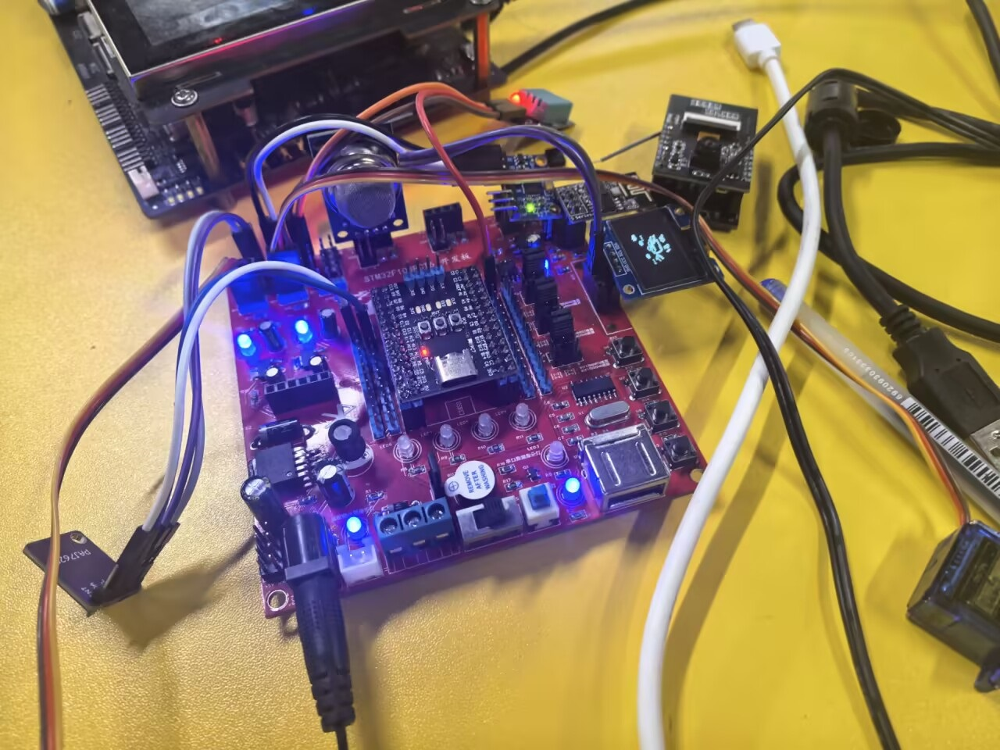
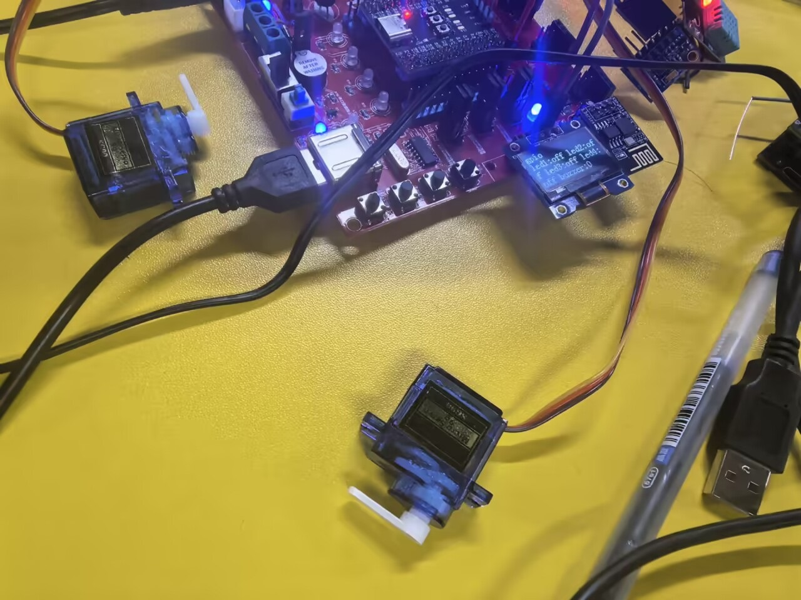
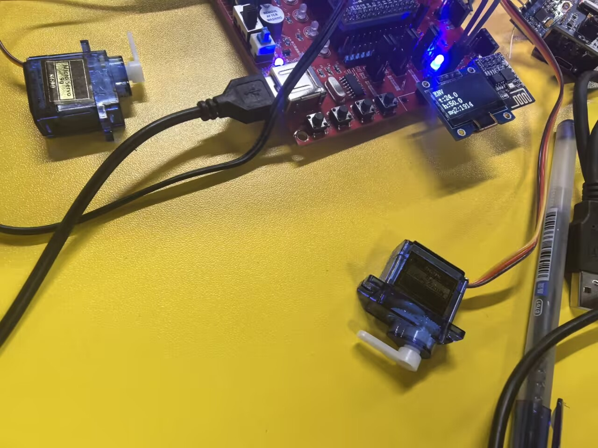
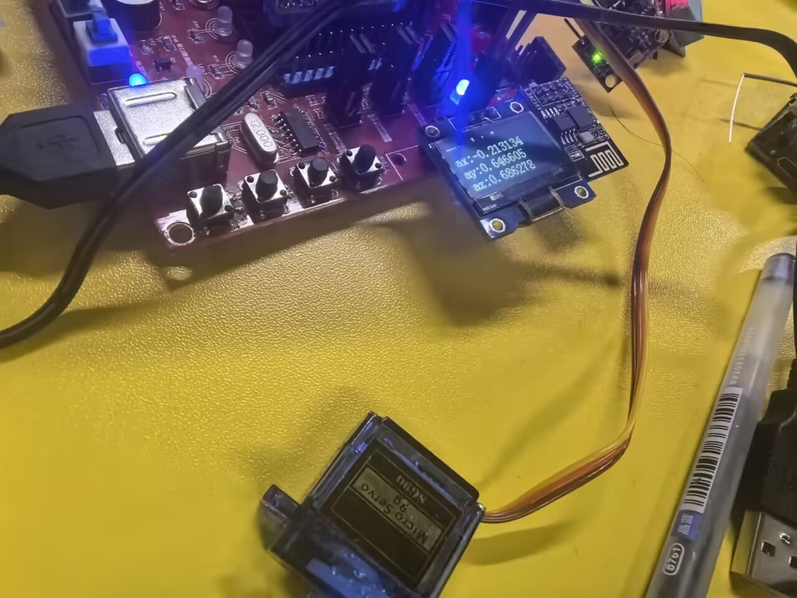
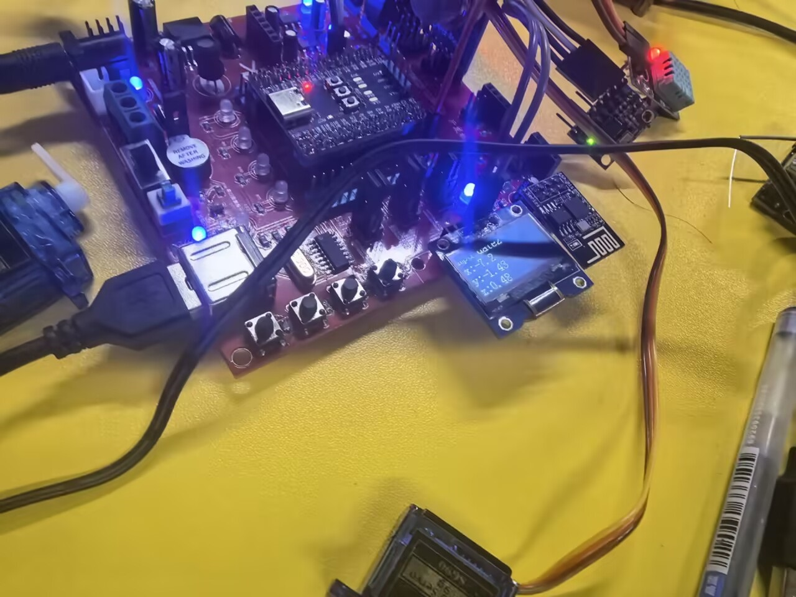
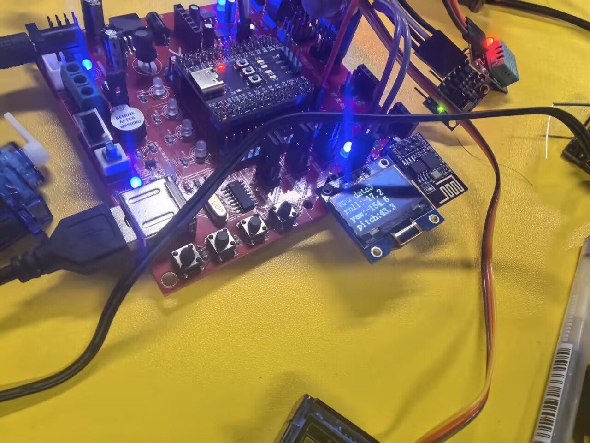
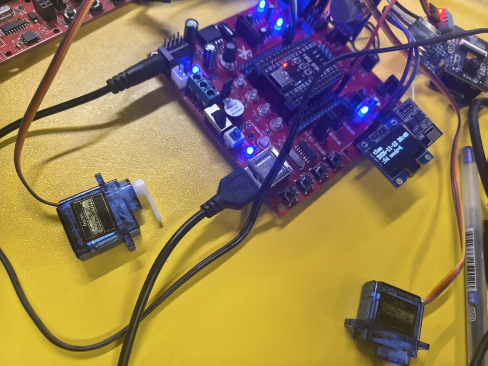
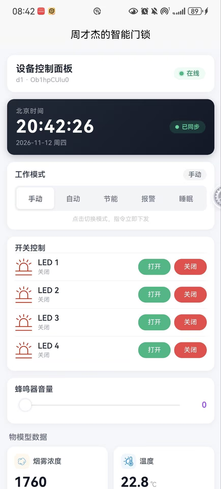
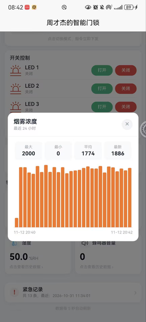

# STM32 智能门锁 · 多模式安防系统

基于 **STM32F103RCT6 + HAL 库** 的智能门锁控制系统，支持**手动开门、自动开门、节能、火灾报警、睡眠（防拆防盗）** 五种工作模式。通过 **ESP8266 + 自实现 MQTT 协议** 接入 OneNET 云平台，配套**移动端 App（uni-app + HBuilderX）** 实现远程开关门、模式切换、实时数据查看。

> **说明**：App 的数据获取逻辑（OneNET 鉴权、token 生成、属性查询与下发、历史数据 API）由本人独立实现；UI 布局与样式在 AI 辅助下完成。STM32 端所有驱动、协议、算法均为自主实现。

> **注**：MPU6050 的零偏补偿参数为本人硬件实测标定值，**换板子需重新标定**，详见 [MPU6050 标定说明](#mpu6050-标定说明)。

> 定位：个人嵌入式软件综合实践项目，重点在 **多传感器融合、状态机设计、协议自实现、安全逻辑优先级设计、云端双向通信** 的完整工程链路。

---

## 📷 效果展示

| 门锁硬件实物 | GPIO 状态 | 环境数据 |
|:---:|:---:|:---:|
|  |  |  |

| MPU6050 加速度 | MPU6050 角速度 | MPU6050 姿态角 |
|:---:|:---:|:---:|
|  |  |  |

| 北京时间显示 | App 主界面 1 | App 主界面 2 |
|:---:|:---:|:---:|
|  |  |  |

> 原理图见 `SCH_Schematic1.pdf`，硬件工程见 `STM32F103RCT6开发板.eprj2`（立创 EDA）。

---

## ✨ 功能特性

### 🎯 五种工作模式（状态机驱动）

| 模式 | 名称 | 触发条件 | 行为 |
|------|------|---------|------|
| 0 | 手动开门 | 默认 | 手势识别控制舵机开门，不自动关闭 |
| 1 | 自动开门 | App 切换 | 手势识别控制开关门，检测到人靠近自动开，延时后自动关 |
| 2 | 节能 | App 切换 | 降低上报频率、关闭非必要外设，手势开门保持 |
| 3 | 火灾报警 | **温度 > 40℃ 且 烟雾 > 2500** | 舵机强制开门（逃生通道）、蜂鸣器 + 全部 LED 告警 |
| 4 | 睡眠（防拆） | App 切换 | **拒绝开门指令**，MPU6050 监控门锁姿态，剧烈晃动/倾斜触发紧急 |
| 6 | 紧急 | mode4 触发 | 蜂鸣器 + LED 告警，等待用户 App 解除 |

**核心安全逻辑**：

- **手动 / 自动 / 节能**：正常开门模式，区别在是否自动关闭、上报频率
- **火灾报警**：温度 + 烟雾**双条件**触发，强制开门保障逃生（**安全优先于防盗**）
- **睡眠模式**：门锁上锁后拒绝一切开门指令，MPU6050 检测门锁被撬、被撞、被倾斜，触发紧急告警（**防盗优先**）
- **两套逻辑互斥且优先级明确**：任何模式下火灾检测每秒执行一次，检测到火灾立即中断当前模式切 mode 3

### 📊 各模块详细说明

| 模块 | 型号 | 通信接口 | 引脚 | 驱动方式 | 关键实现 |
|------|------|---------|------|---------|---------|
| **主控** | STM32F103RCT6 | — | — | HAL 库 | 72MHz（HSE 8MHz × PLL9） |
| **温湿度** | DHT11 | 单总线 | PC0 | GPIO 位操作 + 微秒延时 | TIM3 测高电平时长，40 位串行解析 |
| **烟雾** | MQ2 | ADC | PB0 | ADC1_CH8 | 10 次采样取平均，软件滤波 |
| **姿态** | MPU6050 | I2C | PB6/PB7 | I2C1 标准模式 100kHz | **互补滤波融合陀螺仪积分 + 加速度观测** |
| **手势** | PAJ7620 | I2C | PB6/PB7 | I2C1，共用总线 | 9 种手势（上下左右、前后、顺时针、逆时针、挥手） |
| **舵机（门锁）** | SG90 | PWM | PB8/PB9 | TIM4_CH3/CH4，20ms 周期 | 500~2500μs 脉宽映射 0~180°（0°=关，90°/180°=开） |
| **显示** | SSD1306 OLED | I2C | PB6/PB7 | I2C1，128×64 | 自建 8×16 字库，8 种界面循环 |
| **LED** | — | GPIO | PA11/PA12/PA13/PA14 | 开漏输出 | 低电平点亮 |
| **蜂鸣器** | — | PWM | PA8 | TIM1_CH1，1kHz | 占空比 0~100 对应音量 |
| **按键** | — | GPIO | PA1/PA7/PC4/PC5 | 输入上拉 | TIM1 中断 50ms 消抖 |
| **WiFi** | ESP8266 | UART | PB10/PB11 | USART3 115200 | AT 指令 + MQTT 自实现 |
| **调试串口** | — | UART | PA9/PA10 | USART1 115200 | printf 重定向 |

### 🖥️ OLED 8 种显示界面

通过板载 Key1 循环切换，各界面截图见上方效果图：

1. 开机图标
2. GPIO 状态（LED / 蜂鸣器）
3. PAJ7620 手势历史
4. 环境数据（温湿度 / 烟雾）
5. 北京时间（年月日时分秒星期）
6. MPU6050 加速度
7. MPU6050 角速度
8. MPU6050 姿态角（Yaw / Pitch / Roll）

---

## 🛠️ 关键技术实现

### 1️⃣ 从零实现 MQTT 协议

不依赖 `paho-mqtt` / `MQTT-C` 等第三方库，**手写** MQTT 3.1.1 报文：

- **CONNECT**：可变长度编码（Remaining Length）+ 用户名密码认证
- **PUBLISH**：QoS 0，Topic + Payload 手拼
- **SUBSCRIBE**：订阅 `$sys/.../thing/property/set` 下行属性
- **Remaining Length**：MQTT 特有的 1~4 字节变长编码，小报文省字节，大报文可扩展

### 2️⃣ MPU6050 互补滤波姿态解算

六轴融合，加速度计修正陀螺仪积分漂移：

- **陀螺仪积分**：根据角速度累加角度，含零偏补偿
- **加速度计观测**：通过 `atan2` 计算 pitch / roll 的绝对角度
- **互补融合**：`pitch = 0.95238 × pitch_a + (1 - 0.95238) × pitch_g`，兼顾动态响应和静态稳定
- **滤波系数推导**：`0.95238 = dt / (tau + dt)`，取 `tau ≈ 1s`、`dt = 50ms`。**这个系数和硬件无关**，换板子不用改

### 3️⃣ 中断驱动的 UART 环形缓冲区

USART3 接收中断逐字节写入环形缓冲区，主循环异步读取，**收发解耦**：

- 中断里只做「写指针 + 移动 tail」，不做协议解析
- 主循环用「head / tail 指针」判断缓冲区空/满，**头尾指针用 `(tail+1)%size != head` 区分空和满**
- **双缓冲设计**：一份用于 MQTT 报文解析，一份用于调试打印，互不干扰

### 4️⃣ 状态机 + 门锁防拆检测

主循环按 `stm32_mode` 分发到 6 个模式处理函数，睡眠模式（mode 4）下的防拆逻辑：

- 进入 mode 4 时记录当前 yaw/pitch/roll 作为**基准姿态**
- **任一角度变化 > 90°** → 门锁被**翻倒、拆卸**，立即触发紧急
- **连续 3 次任一角度变化 > 30°** → 门锁被**缓慢撬动、撞击**，累积 3 次触发紧急
- **各角度变化 < 30°** → 正常噪声，清零计数
- 同时读取 PAJ7620 的 0x6B 寄存器，**检测到有人靠近但门锁未收到开门指令**，也判定为异常，配合 MPU 双重确认

### 5️⃣ 火灾检测双条件触发

- **温度 > 40℃**：DHT11 整字节温度，过滤瞬时噪声
- **烟雾 > 2500**：MQ2 的 ADC 原始值，10 次采样平均
- **双条件同时满足**才触发，避免单一传感器误报（如厨房做饭、抽烟）
- 触发后**舵机强制开门**，安全优先于防盗——火灾时逃生第一
- 每个 mode（0/1/2/4）开头都有这个检查，**火灾检测优先级最高**，任何模式下一秒检测到火灾立即切 mode 3

### 6️⃣ DHT11 微秒级时序

用 **TIM3（72MHz，1 分频）** 做微秒延时，满足 DHT11 严格的时序要求（起始信号 18ms 低电平、40 位数据的高电平宽度测量）。**不能用 `HAL_Delay`**，因为它的最小粒度是 1ms，无法满足 DHT11 微秒级要求。

### 7️⃣ 定时器任务调度

| 定时器 | 周期 | 任务 |
|--------|------|------|
| **TIM1** | 1ms | 按键 50ms 消抖、DHT11 5s 采集标志、Unix 时间戳自增 |
| **TIM2** | 50ms | MPU6050 姿态更新（互补滤波） |
| **TIM3** | 1μs | DHT11 / 舵机等微秒级时序 |
| **TIM4** | 20ms | SG90 门锁舵机 PWM |

---

## 📐 MPU6050 标定说明

互补滤波的陀螺仪零偏补偿值为**本硬件实测标定**：

- `7.438`、`1.102`、`-0.133` 是**上电静置 10 秒取平均**得到的零偏值（X / Y / Z 三轴）
- **更换 MPU6050 模块或 PCB 后必须重新标定**，否则姿态会持续漂移
- **标定方法**：静止放置，串口输出连续 100 帧 `mpu_x/y/z`，取平均即为零偏
- **标定流程**：循环 100 次，每 10ms 读一次六轴数据并累加，最后除以 100 得到三轴均值，填入 `mpu6050_get0` 的补偿项

---

## 📱 移动端 App 控制端

> **数据获取逻辑（OneNET token 生成、属性查询/下发 API、历史数据 API）为本人独立实现**；UI 布局与样式在 AI 辅助下完成。

基于 **uni-app 框架 + HBuilderX** 开发的移动端 App，通过 OneNET 官方 API 与 STM32 交互：

- **顶部状态栏**：设备在线/离线状态 + 北京时间（自动同步）
- **工作模式切换**：手动 / 自动 / 节能 / 火灾 / 睡眠 五档分段控制
- **门锁控制**：远程开锁按钮，睡眠模式下禁用（防误开）
- **开关控制**：4 路 LED 独立开关 + 蜂鸣器音量滑条
- **数据卡片**：烟雾浓度、温度、湿度、蜂鸣器音量，点击查看 24 小时历史曲线
- **紧急横幅**：门锁进入紧急/火灾模式时置顶提示
- **紧急记录**：本地持久化存储，支持历史追溯
- **模式锁定**：紧急模式下所有控制按钮自动禁用，等待设备退出

---

## 🔨 编译与烧录

**STM32 端**：

- STM32CubeIDE 或 Keil MDK
- STM32F1xx HAL 库（v1.8.x）
- 时钟配置：HSE 8MHz × PLL9 = 72MHz

**App 端（HBuilderX）**：

1. 用 HBuilderX 打开 `app/` 项目目录
2. 修改 `key.js` 中的 `access_key` 为你的 OneNET 产品密钥
3. 选择「运行 → 运行到手机或模拟器」直接调试，或「发行 → 原生 App-云打包」生成 APK

---

---

## ⚠️ 已知限制与改进方向

| 类别 | 问题 | 改进方向 |
|------|------|---------|
| **硬件标定** | MPU6050 零偏补偿值绑定当前硬件 | 增加开机自动标定流程，用户静置 10s 自动采集零偏 |
| 协议健壮性 | MQTT 未实现 QoS 1/2 重传，弱网丢包无法恢复 | 增加 packet_id 追踪 + PUBACK 等待 |
| 阻塞式通信 | `send_esp_cmp` 用 `HAL_Delay` 等待应答，会阻塞主循环 | 改为状态机 + 中断回调 |
| 火灾误报 | 双阈值固定（40℃ / 2500），未做温升速率判断 | 增加「温升速率 > X℃/min」辅助判断 |
| 门锁安全 | 远程开门无身份二次验证 | 增加 PIN 码 / 生物识别二次确认 |
| 内存管理 | 多个模块使用固定 256/512 字节缓冲区 | 改用内存池或动态分配 |
| 硬件耦合 | 引脚定义分散在各头文件 | 统一到 `board_config.h` |
| 测试覆盖 | 无自动化测试 | 增加环形缓冲区、MQTT 编码的单元测试 |
| 安全 | OneNET 密钥硬编码在 `key.js` | 迁移到服务端代理 / 加密存储 |

---

## 📄 License

MIT

---

## 🏗️ 系统架构
┌─────────────────────────────────────────────────────┐
│ 移动端 App (uni-app + HBuilderX) │
│ 远程开关门 · 模式切换 · 实时数据 · 紧急记录 │
└──────────────────────┬──────────────────────────────┘
│ HTTPS (OneNET API)
┌──────────────────────▼──────────────────────────────┐
│ OneNET 物联网平台 │
│ MQTT Broker (183.230.40.96) │
└──────────────────────┬──────────────────────────────┘
│ MQTT over TCP
┌──────────────────────▼──────────────────────────────┐
│ ESP8266 │
│ AT 指令 · 透明传输 (USART3) │
└──────────────────────┬──────────────────────────────┘
│ UART 115200 + 环形缓冲区
┌──────────────────────▼──────────────────────────────┐
│ STM32F103RCT6 │
│ ┌───────────────────────────────────────────────┐ │
│ │ 状态机 (stm32_mode: 0/1/2/3/4/6) │ │
│ ├───────────────────────────────────────────────┤ │
│ │ 安全逻辑 │ │
│ │ 火灾检测（双条件）· 防拆检测（IMU 姿态） │ │
│ ├───────────────────────────────────────────────┤ │
│ │ MQTT 协议栈 (自主实现) │ │
│ │ CONNECT / PUBLISH / SUBSCRIBE / 变长编码 │ │
│ ├───────────────────────────────────────────────┤ │
│ │ 传感器层 │ │
│ │ DHT11 · MQ2 · MPU6050 · PAJ7620 │ │
│ ├───────────────────────────────────────────────┤ │
│ │ 执行器层 │ │
│ │ LED×4 · 蜂鸣器 · SG90 门锁舵机 │ │
│ ├───────────────────────────────────────────────┤ │
│ │ 显示层 │ │
│ │ SSD1306 OLED · 8 种界面 │ │
│ └───────────────────────────────────────────────┘ │
└─────────────────────────────────────────────────────┘

**数据流**：App → HTTPS → OneNET → MQTT → ESP8266 → UART → STM32，双向通信。上行数据（温度、湿度、烟雾、LED 状态、模式）周期上报，下行指令（开关门、模式切换、时间戳）实时下发。

---

## 👤 关于

本项目为个人嵌入式软件综合实践，实现了一个**功能完整的智能门锁原型**，涵盖 **GPIO / UART / I2C / ADC / TIM / PWM / 中断** 全外设使用：

- **安全逻辑设计**：火灾时强制开门（逃生优先），睡眠时拒绝开门（防盗优先），两套逻辑互斥且优先级明确
- **多传感器融合**：温度 + 烟雾双条件判断火灾（防误报），IMU 姿态 + 手势识别判断入侵（防拆）
- **协议自实现**：MQTT 3.1.1 从零实现，不依赖第三方库，含 Remaining Length 变长编码
- **端云协同**：STM32 + ESP8266 + OneNET + 移动端 App 全链路打通
- **算法实现**：互补滤波姿态解算（含硬件标定零偏补偿）、防盗三档阈值检测算法

**技术栈**：

| 类别 | 内容 |
|------|------|
| 主控 | STM32F103RCT6（72MHz，HAL 库） |
| 通信 | USART ×2、I2C、ADC、PWM |
| 协议 | MQTT 3.1.1（自实现）、AT 指令 |
| 云平台 | OneNET 物联网平台 |
| 前端 | uni-app + HBuilderX 移动端 App（数据逻辑自主，UI 布局 AI 辅助） |
| 外设 | DHT11、MQ2、MPU6050、PAJ7620、SG90、SSD1306 |
| 算法 | 互补滤波、姿态防盗检测、火灾双条件检测 |

---

## 📂 源码

完整源码见仓库：

- STM32 端：`USER/` 目录下各模块 `.c / .h`
- App 端：`app/` 目录（uni-app + HBuilderX）
- 硬件工程：`STM32F103RCT6开发板.eprj2`（立创 EDA）

**核心文件说明**：

| 文件 | 说明 |
|------|------|
| `USER/main.c` | 主逻辑 + 5 模式状态机 + 火灾检测 + 防盗检测 |
| `USER/esp8266.c` | MQTT 3.1.1 协议实现（CONNECT/PUBLISH/SUBSCRIBE） |
| `USER/mpu6050.c` | 互补滤波姿态解算 + 防拆检测算法 |
| `USER/paj7620.c` | 手势识别 + 舵机联动 |
| `USER/DH11.c` | DHT11 微秒级时序驱动 |
| `USER/mq2.c` | MQ2 ADC 采样 + 软件滤波 |
| `USER/OLED.c` | SSD1306 显示驱动 + 8 种界面 |
| `app/pages/index/index.vue` | App 主界面 + OneNET API 调用 |
| `app/key.js` | OneNET token 鉴权生成 |

如有问题或建议，欢迎提 Issue 或 PR。
